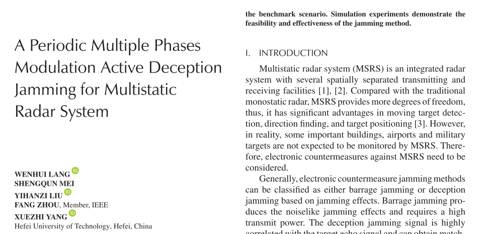
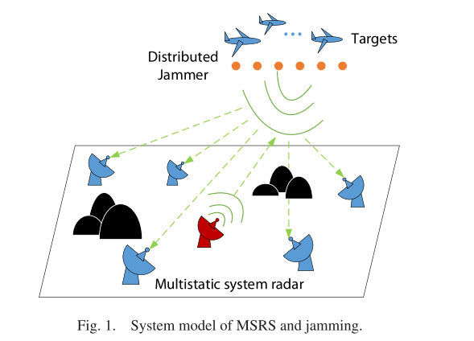
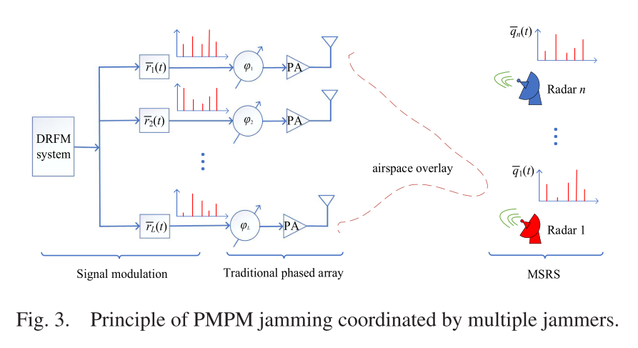
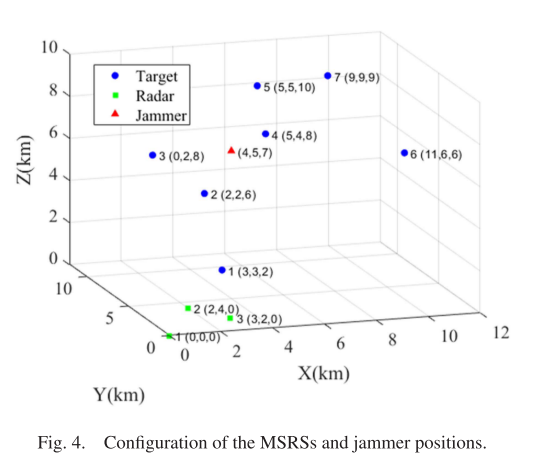
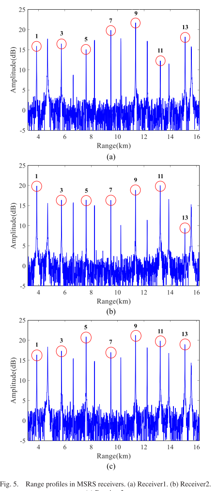
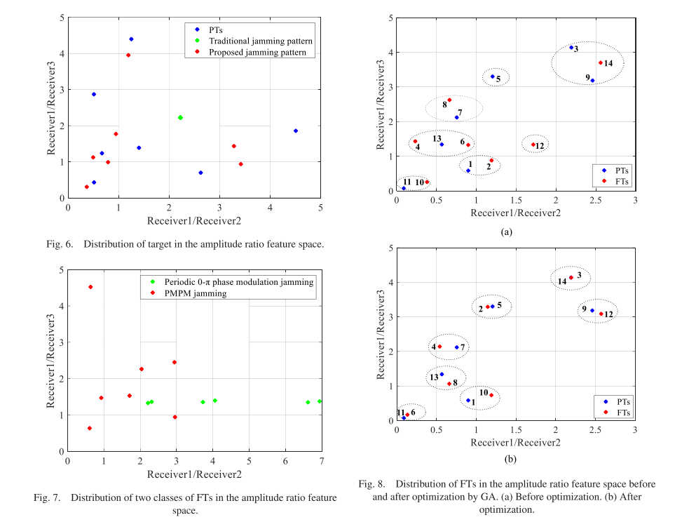
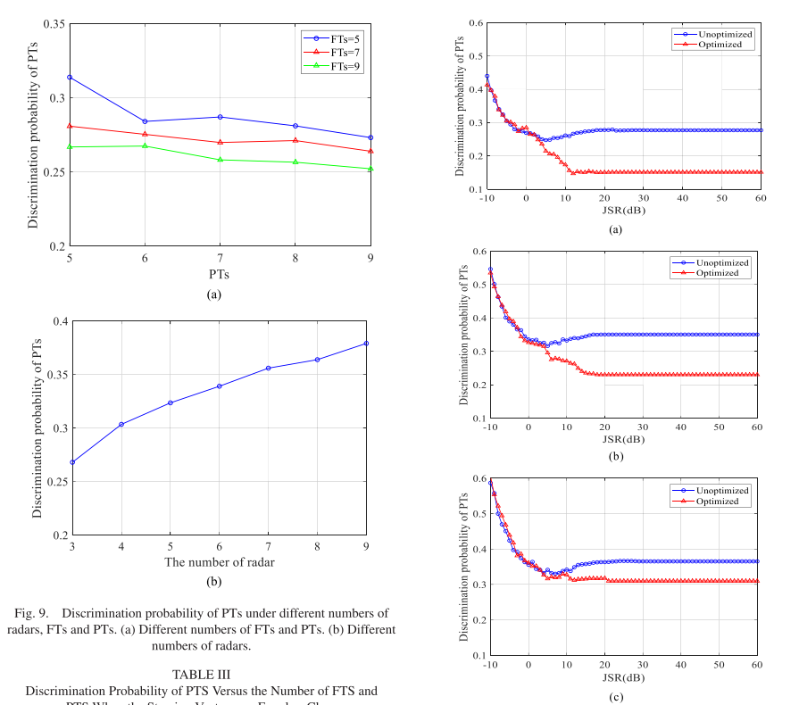

# Radar Active Jamming with Multiple Base Stations - Periodic Multi-Phase Modulation Active Jamming

Introduction to Multi-Site Radar Systems (MSRS): A comprehensive radar system with multiple spatially separated transmitters and receivers [1] [2]. Compared to traditional single-site radars, MSRS offers greater flexibility in dynamic target detection, direction finding, and target positioning, among other advantages [3]. However, in practice, some critical buildings, airports, and military targets are not expected to be monitored by MSRS. Therefore, electronic countermeasures against MSRS need to be considered.
Based on the different types of interference effects, electronic countermeasures can generally be divided into jamming and deception methods. Jamming generates noise-like interference effects that require high transmission power. Deceptive interference signals are highly correlated with the target echo signals, allowing for matched gain. Particularly, multi-false target deception interference based on digital radio frequency memory (DRFM) technology not only preserves the echo characteristics of physical targets but also confuses the radar system, adding to the burden of identifying physical targets and wasting limited radar resources. In the face of deceptive interference threats, multi-target radar is considered an effective countermeasure. As long as MSRS has sufficient differences in perspectives relative to the target, the received target signals from each radar are uncorrelated. Since the interference signal is generated by the same jammer, the interference signals received by each radar are correlated [4] [5]. Based on this principle, MSRS finds the difference between the interference signal and the target signal at different signal levels and distinguishes them. For example, in a feature space established based on amplitude ratio differences, PT exhibits dispersion characteristics, while false targets (FT) have concentration characteristics, which is particularly suitable for using unsupervised learning methods to effectively identify deceptive interference [6] [7]. Theoretical analysis and simulation verification have demonstrated the effectiveness of this method, thus, researching new countermeasures against MSRS has become an increasingly pressing demand.
Firstly, the effective methods of deception interference to counter new-system radars have always been a focal point in the field of jamming. Wu et al. [8] analyzed the SAR imaging characteristics of deceptive micro-motion targets. By setting different motion parameters for rotating micro-motion targets, multiple types of stripe images with equal intervals were formed on the azimuth angle of SAR. This result lays the foundation for using target micro-motion characteristics to interfere with radars. Zhou et al. [9] applied rotating angle reflectors to form multiple pseudo targets on the "grid" of SAR-GMTI two-dimensional images, effectively covering protected targets. However, traditional passive devices have fixed scattering cross-sections, making it difficult to flexibly modulate SAR target characteristics. In literature [10], active frequency selective surfaces are used as passive materials to generate flexible and controllable multiple FTs in two-dimensional SAR images. Similarly, a two-dimensional image modulation method based on phase switching screen (PSS) was proposed for SAR images. This method modulates the radar reflection signal through PSS, thereby forming multiple FTs with realistic characteristics around protected targets in two dimensions [11]. These passive multi-frequency interference methods do not require active emission of electromagnetic signals from outside, are simple to operate, cost-effective, but lack diversity in interference styles.
In the literature [12], a DRFM jammer was employed to delay, modulate, and forward intercepted SAR signals, thereby obtaining multiple pseudo targets with the same backscatter characteristics as PTs in the receiver. Tang et al. [13] suggested that by convolving the jammer's received signal with the video signal, multiple FTs could be created within each pulse. However, this method requires post-processing of the entire radar pulse for modulation and forwarding, which would result in FTs forming behind real targets. To address this issue, Wang et al. [14] proposed an interrupt sampling forward jamming method. The jammer periodically samples and repeats the intercepted signal, resulting in multiple true FTs in the radar's received interference signal, some of which are located before PTs. The limitation of this interrupt sampling forward jamming method is its limited interference range and regular distribution of FTs. Subsequent studies focused on increasing the number of FTs to expand the interference range, but they still failed to resolve the issue of the interference signal's regularity [15], [16]. Fang and Wang [17] proposed a two-dimensional interrupt sampling forward SAR jamming method based on convolutional modulation. This method disrupts the periodic distribution of frequency shifters to some extent, reduces the uneven power distribution of primary and secondary frequency shifters, and further expands the interference range. However, the amplitude of the pseudo targets is not random; it is vulnerable in the MSRS environment.
Currently, there is limited research on methods to interfere with MSRS. Zhen et al. [18] introduced methods for pseudo-target and cross-polarization interference against dual/multi-base radars, but these interference techniques cannot counteract the large aperture and multi-view characteristics of MSRS. Zhao et al. [19] studied the interference capabilities of relayed interference against MSRS, deriving conditions for the effectiveness of relayed interference and providing theoretical guidance for the design and anti-interference methods of MSRS. MSRS inherently possesses advantages in anti-interference, making it difficult for single-antenna interference devices to effectively combat MSRS. Therefore, some researchers have utilized multiple interference devices to counter MSRS [20], [21], [22], [23]. To enhance anti-MSRS performance, these interference methods consider resource allocation based on different criteria, such as game theory [20], minimizing mutual information between radar receiving and transmitting signals [22], and minimizing mean square error in target estimation. For distributed MIMO radars, Zheng et al. [24] proposed a blocking interference strategy that maximizes signal-to-noise ratio as the criterion for interference resource allocation, thereby reducing the precision of target parameter estimation for distributed MIMO radars. Additionally, using an interference network to counter MSRS is also a natural idea. In literature [25], a dual-source interference device was proposed to counter distributed radars, which generates pseudo trajectories in the radar by designing trajectory, amplitude, and delay. Sun et al. [26] utilized multiple UAVs to coordinate against MSRS, thus forming decoy tracks at the information fusion center of MSRS. By planning the movement paths of the interference devices reasonably, the complexity of track deception was reduced, enhancing the probability of successful interference. Wang et al. [27], [28] proposed random subset selection interference methods to counter multiple target satellites. The interference array antennas randomly excite, with the main beam stable and the side lobes random. This method introduces randomness into the phase difference of received signals, effectively reducing the performance of subspace interference cancellation methods based on MSRS. The random subset selection interference method produces noise-like blockage interference effects.
The modulation method in which the phase value of the carrier varies proportionally to the deviation from its reference signal and the instantaneous value of the modulation signal is known as phase modulation. When the instantaneous phase alternates between two or more specific phase values, it is referred to as biphase or multiphase modulation. When the instantaneous phase irregularly changes at uncertain phase values, it is termed random phase modulation [29], [30]. Inspired by the phase modulation technology in radar waveform design, many scholars have introduced phase modulation techniques into the design of interference signals [31], [32], [33]. Liu et al. [34] proposed a SAR forward-scattering interference method based on cosine phase modulation. The principle involves utilizing DRFM technology to add corresponding phases to the received SAR signal each time it moves forward, thus achieving cosine phase stabilization in the slow time domain for the forward signal, allowing discrete FT sequences to be generated in the azimuth direction. [35] introduced an inter-cycle phase modulation interference technique based on discontinuous sampling, whereby the discontinuous sampling signal is multiplied by square phases related to the order, addressing the issue of rapid amplitude decay of sub-false targets. Gu et al. [36] proposed a multi-phase segmented modulation interference method for linear FMCW radars based on phase modulation principles. By segmenting the signal in the time domain and modulating different phase values for each segment, they generate distance-controllable noise-like interference effects. Shi et al. [37] utilized phase modulation technology to design a periodic biphase phase modulation interference method and applied it to ISAR interference. The interference machine intercepts the radar signal, periodically modulates the two-phase phase in both fast and slow time domains, then forwards this to the target area to form scattering wave interference signals, thereby forming FT groups on the ISAR two-dimensional image.
This article expands upon the work presented in [38]. It provides a detailed explanation of the principles behind multi-interference jamming, analyzes the amplitude compensation and amplitude-related performance of this interference style, derives the rank of the amplitude-related factor matrix, and demonstrates that FT exhibits dispersion in the amplitude ratio space. To maintain completeness, some sections are repeated. The structure of this article is as follows: Section two establishes the signal model for multiple satellites, introduces the interference styles and identification steps for these satellites, including both traditional and proposed interference styles. Section three analyzes the amplitude of the interference and presents an interference optimization algorithm. Section four details the simulation results and analysis. Finally, section five concludes the paper.
Article illustrations
Conclusions: For mobile satellite systems employing unsupervised learning algorithms, a method for multi-jammer cooperative deception jamming is proposed. The jammer system utilizes PMPM with different modulation phase sequences, while each jammer employs a different set of modulation phase sequences. This disrupts the amplitude correlation in the Fourier transform of MSRS radar receivers, leading to randomness in the amplitude-to-feature space of the Fourier transform, thereby reducing the interference suppression performance of MSRS. Notably, an optimization method for jamming modulation parameters based on genetic algorithms has been realized. Through unsupervised learning, the discrimination probability of PT effectively decreases to 14% under benchmark scenarios. The innovation of this paper lies in the fact that the characteristics of the FTS generated by the PMPM method change with the change in modulation sequence. By employing the PMPM method with different modulation phase sequences and then jointly transmitting beamforming, multiple jammers disrupt the amplitude "coherence" of signals received by different ground-based radars in MSRS, thus reducing the interference identification performance of MSRS.

## Images

<!-- PAYMENT_BLOCK -->

## Get this dataset

- Payment link (Stripe): [Buy now](https://buy.stripe.com/3cs8yP7sY87d0vu9AB)
- Payment QR code: 

<!-- /PAYMENT_BLOCK -->
